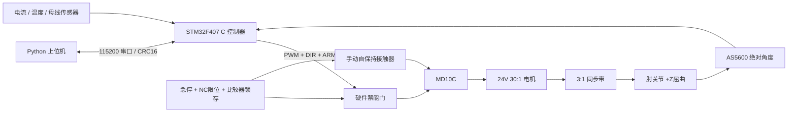

# Open Elbow Exoskeleton

中文 | [English](README_EN.md)

面向科研、教学和控制算法研究的模块化单肘关节外骨骼开源工程。首版交付参数化机械设计、STM32F407 C 固件、Python 台架上位机及使用同一控制核心的单关节仿真。

**当前阶段：软件与仿真原型。没有实体台架或佩戴实测。** 0.5 Nm 连续、1 Nm/1 s 短时助力、1 rad/s 速度和1.5 kg穿戴质量均为设计目标；电流到力矩关系是计算估算。按“软件仿真 → 单关节台架 → 佩戴验证”推进。


## 首版内容

| 子系统 | 实际交付 | 状态边界 |
|---|---|---|
| 机械 | CadQuery 参数化源、总装与逐件 STEP/STL、尺寸图、装配及受力计算 | 几何模型；未加工、未载荷测试 |
| 驱动 | Pololu 4692 24V 30:1 减速电机、20/60齿同步带、90:1总减速 | 已选型；电机温升、回驱和力矩待台架验证 |
| 电气 | 接线SVG、引脚、线表、三档BOM、急停/限位/过流/过温/禁能电路说明 | 接线设计；非已装配电路板 |
| 固件 | 纯C控制核心、STM32F407VET6板级实现、原生模拟器及测试 | 实际构建记录见[验证报告](docs/validation/README.md) |
| 上位机 | 串口/模拟连接、显式校准和运行、配置、状态、CSV记录、曲线、Tk界面 | 通信模拟端到端已运行 |
| 仿真 | URDF、一自由度动力学、同一C控制器、轨迹及故障注入 | 合成模型与传感器；不等同硬件性能 |

## 快速开始（无需硬件）

在仓库根目录，用 Python 3.10–3.12（CAD推荐3.12）创建环境。Windows PowerShell：

```powershell
py -3.12 -m venv .venv
.venv\Scripts\Activate.ps1
python -m pip install -e ".[test]" ziglang==0.14.1
python firmware/build.py --target host
python -m elbow_exo demo --output artifacts/demo
python -m elbow_exo gui --port sim
```

Linux/macOS（已安装本机C编译器）：

```bash
python3 -m venv .venv
source .venv/bin/activate
python -m pip install -e '.[test]'
python firmware/build.py --target host
python -m elbow_exo demo --output artifacts/demo
```

演示完成真实进程通信、心跳、零位校准、模拟夹具手动移位、运行、停止、CSV和绘图。`artifacts/demo/` 保存生成结果。GUI依赖系统Tk；Linux可安装`python3-tk`。

交互台架控制与绘图：

```bash
python -m elbow_exo console --port sim --log artifacts/bench.csv
python -m elbow_exo console --port COM5 --log artifacts/physical-bench.csv
python -m elbow_exo plot artifacts/bench.csv --output artifacts/bench.png
```

模拟台架依次输入 `CAL`，等待校准完成，再输入 `inject Q 0.225`、`ARM`、`TARGET 0.5`、`status`、`STOP`。数值使用rad、rad/s、Nm。实体台架由操作者在夹具中移动关节，**没有 `inject` 功能**。故障复位要求物理按钮及RESET，复位后还需重新校准。v0.1的序号从0开始，新上位机会话连接实体控制器前需复位控制器以重新建立序号会话。

## 架构与统一约定



[config/robot.json](config/robot.json)是参数唯一来源。伸直为零，右手定则绕+Z屈肘为正，开式同步带同向；固件、URDF和机械尺寸共同读取。软件范围10–120°，机械挡块0–130°。更改参数后重新生成固件头、URDF及CAD；不要只改某一个模型。

## 工程资料

- [需求、计算、传动比较与验收标准](docs/engineering.md)
- [机械源、STEP/STL、图纸、材料与装配](mechanical/README.md)
- [接线、引脚、电源、BOM与采购来源](hardware/README.md)
- [固件构建、烧录、校准、故障码与协议](firmware/README.md)
- [上位机、仿真及测试说明](docs/OPERATIONS.md)
- [实际验证记录](docs/validation/README.md)；[台架与佩戴记录表](docs/HARDWARE_TESTS.md)
- [首版预算](hardware/BOM.md)、[贡献指南](CONTRIBUTING.md)、[路线图](docs/ROADMAP.md)、[第三方来源](THIRD_PARTY.md)

## 构建与验证

安装GNU Arm Embedded工具链并使`arm-none-eabi-gcc`可用：

```bash
python firmware/build.py --target stm32
python -m pytest -q
python simulation/build_model.py
python simulation/validate.py --output artifacts/simulation
python -m pip install '.[cad]'
python mechanical/build_cad.py
```

固件输出`firmware/build/stm32/open_elbow.elf`和`.bin`。SWD烧录及具体接线见固件和硬件文档。未假定本机已有任何控制板、电机或电源。ROS 2 仅是后续可选接口；首版运行不需要ROS。

## 许可证

软件（`firmware/`、`software/`、`simulation/`代码、`tests/`、`tools/`及CI）使用 **Apache-2.0**。原创硬件设计（`mechanical/`设计及导出文件、`hardware/`接线设计）使用 **CERN-OHL-W-2.0**。原创文档和说明性图示使用 **CC-BY-4.0**。详见[许可证范围](LICENSE.md)；第三方文件保留原许可证。

## 常见问题

**没有电机能否运行？** 可以，默认`sim`连接本机编译的同一C控制器。模拟模式不代表实体硬件已通过验证。

**电流就是力矩吗？** 当前使用厂商堵转外推数据推导的映射，未含静摩擦、效率变化和温升；需要砝码/力传感器标定。

**可以直接打印整机吗？** 主承力板、轴、轮毂和挡块按金属件设计。打印件用于尺寸验证、护罩和贴合样件，详见机械文档。

**为什么不采用更大力矩？** 首版聚焦低成本控制链与台架可复现性。结构强度、驱动热性能、关节对齐和人体适配尚待实体测试。

