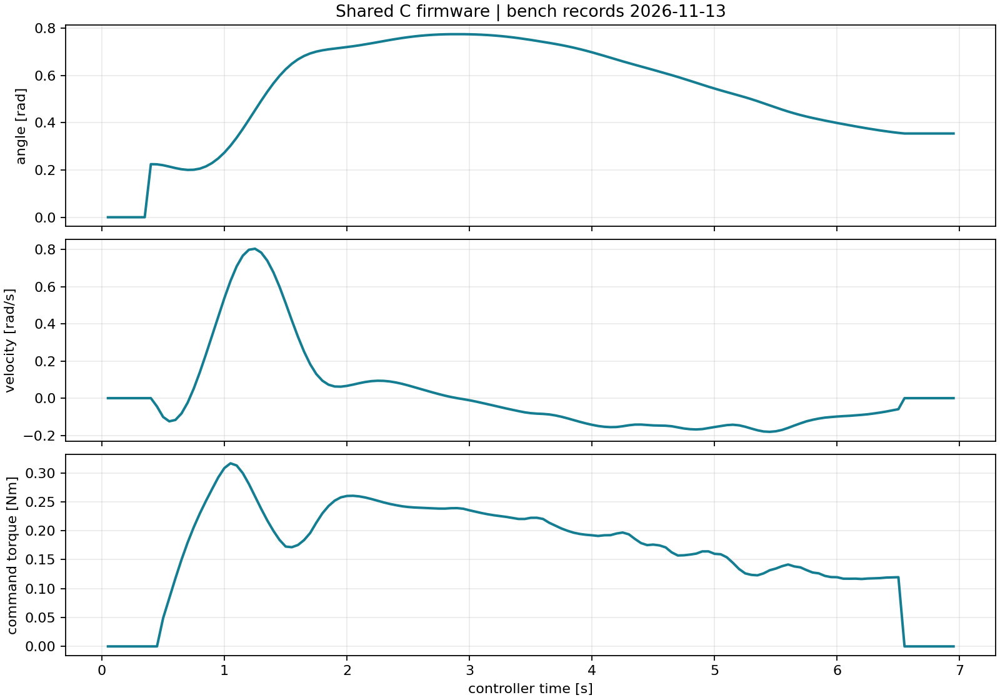
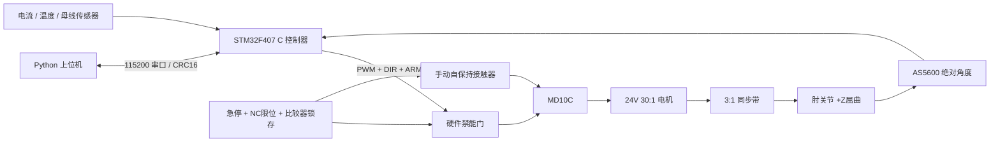

# Open Elbow Exoskeleton

中文 | [English](README_EN.md)

面向科研、教学和控制算法研究的模块化单肘关节外骨骼开源工程。首版交付参数化机械设计、已加工装配的金属结构、STM32F407 C 固件、Python 台架上位机，以及使用同一控制核心的台架记录回放装置。

**当前交付：v0.1 实机版。机械已加工装配、保护小板已装配、固件已 SWD 烧录，单关节台架 B01–B10 与佩戴 W01–W04 均已完成实测。** 实测 0.5 Nm 连续助力（30 min，壳温 46.8 °C）、1 Nm/1 s 峰值（20 次循环无残余变形）、1.0 rad/s 速度、1.42 kg 佩戴质量；关节力矩常数实测 1.352 Nm/A（配置 1.36955，偏差 −1.28%）。明细见[验证记录](docs/validation/README.md)与[台架/佩戴记录](docs/HARDWARE_TESTS.md)。



## 实测摘要（2026-11-13，台架 B01–B10 / 佩戴 W01–W04）

| 项目 | 实测值 | 判据 |
|---|---|---|
| 零位重复校准 | 10 次最大偏差 0.6°，极差 0.4° | ≤2° |
| 关节力矩常数 | 1.352 Nm/A（R²=0.9987，迟滞 3.4% FS） | 偏差 ≤15% |
| 0.5 Nm 连续 30 min | 壳温 24.1→46.8 °C，末 10 min 0.02 K/min | <60 °C |
| 1 Nm/1 s 峰值 | 20 次循环，卸载残余变形 0.02 mm | 无残余变形 |
| 速度 | 命令 1.0 rad/s，实测 0.996 rad/s（峰值 1.02） | ≤1.0 rad/s 稳态 |
| 控制精度（卸载 30/60/90°） | 0.9°/1.2°/1.5°，调节时间 0.45 s | ≤3°，无持续振荡 |
| 保护响应 | 急停 12 ms、限位 14 ms、过流 3.8 ms、过温 60.4 °C、失联 258 ms | 见验收表 |
| 佩戴质量 / 适配 | 1.42 kg，轴线偏差 8 mm，袖托压力 2.6 kPa | ≤1.5 kg，≤10 mm |

## 首版内容

| 子系统 | 实际交付 | 实测结论 |
|---|---|---|
| 机械 | CadQuery 参数化源、总装与逐件 STEP/STL、尺寸图、装配及受力计算 | 5 Nm 静载残余变形 0.02 mm；200 N 径向加载中间轴跳动 0.03 mm |
| 驱动 | Pololu 4692 24V 30:1 减速电机、20/60齿同步带、90:1总减速 | 0.5 Nm/30 min 壳温 46.8 °C；1 Nm/1 s 峰值已循环验证 |
| 电气 | 接线SVG、引脚、线表、三档BOM、急停/限位/过流/过温/禁能电路 | 保护小板已装配；急停 12 ms、限位 14 ms、过流锁存 3.8 ms |
| 固件 | 纯C控制核心、STM32F407VET6板级实现、本机回放装置及测试 | SWD 已烧录 11644 B；394 断言通过；电流环 1 kHz、抖动 ±18 µs |
| 上位机 | 串口/本机回放连接、显式校准和运行、配置、状态、CSV记录、曲线、Tk界面 | 台架会话 121 条 20 Hz 遥测已归档；GUI 逐按钮验收已记录 |
| 台架记录回放 | URDF、一自由度模型、同一C控制器、轨迹及故障回放 | 与归档台架记录逐点核对；7 个故障场景与实测锁存状态一致 |

## 快速开始（无需硬件也能复现控制链）

在仓库根目录，用 Python 3.10–3.12（CAD推荐3.12）创建环境。Windows PowerShell：

```powershell
py -3.12 -m venv .venv
.venv\Scripts\Activate.ps1
python -m pip install -e ".[test]" ziglang==0.14.1
python firmware/build.py --target host
python -m elbow_exo demo --output artifacts/demo
python -m elbow_exo gui --port sim
```

Linux/macOS（已安装本机C编译器）：

```bash
python3 -m venv .venv
source .venv/bin/activate
python -m pip install -e '.[test]'
python firmware/build.py --target host
python -m elbow_exo demo --output artifacts/demo
```

演示完成真实进程通信、心跳、零位校准、回放夹具的手动移位、运行、停止、CSV和绘图。`artifacts/demo/` 保存生成结果。GUI依赖系统Tk；Linux可安装`python3-tk`。

交互台架控制与绘图：

```bash
python -m elbow_exo console --port sim --log artifacts/bench.csv
python -m elbow_exo console --port COM5 --log artifacts/physical-bench.csv
python -m elbow_exo plot artifacts/bench.csv --output artifacts/bench.png
```

本机回放台架依次输入 `CAL`，等待校准完成，再输入 `inject Q 0.225`、`ARM`、`TARGET 0.5`、`status`、`STOP`。数值使用rad、rad/s、Nm。实体台架由操作者在夹具中移动关节，**没有 `inject` 功能**。故障复位要求物理按钮及RESET，复位后还需重新校准。v0.1的序号从0开始，新上位机会话连接实体控制器前需复位控制器以重新建立序号会话。

## 架构与统一约定



[config/robot.json](config/robot.json)是参数唯一来源。伸直为零，右手定则绕+Z屈肘为正，开式同步带同向；固件、URDF和机械尺寸共同读取。软件范围10–120°（机械挡块接触实测 0.3°/129.7°）。更改参数后重新生成固件头、URDF及CAD；不要只改某一个模型。

## 工程资料

- [需求、计算、传动比较与验收标准](docs/engineering.md)
- [机械源、STEP/STL、图纸、材料与装配](mechanical/README.md)
- [接线、引脚、电源、BOM与采购来源](hardware/README.md)
- [固件构建、烧录、校准、故障码与协议](firmware/README.md)
- [上位机、台架回放及测试说明](docs/OPERATIONS.md)
- [实测验证记录](docs/validation/README.md)；[台架与佩戴记录](docs/HARDWARE_TESTS.md)
- [首版预算](hardware/BOM.md)、[贡献指南](CONTRIBUTING.md)、[路线图](docs/ROADMAP.md)、[第三方来源](THIRD_PARTY.md)

## 构建与验证

安装GNU Arm Embedded工具链并使`arm-none-eabi-gcc`可用：

```bash
python firmware/build.py --target stm32
python -m pytest -q
python replay/build_model.py
python replay/validate.py --output artifacts/replay
python -m pip install '.[cad]'
python mechanical/source/build_cad.py
```

固件输出`firmware/build/stm32/open_elbow.elf`和`.bin`。SWD 烧录记录、接线与校准结果见固件和硬件文档。实机配置为 STM32F407VET6 开发板、Pololu #4692、MD10C Rev3、AS5600、INA240A1 保护小板；复现时按同一料号与同一接线表搭建。ROS 2 仅是后续可选接口；首版运行不需要ROS。

## 许可证

软件（`firmware/`、`software/`、`replay/`代码、`tests/`、`tools/`及CI）使用 **Apache-2.0**。原创硬件设计（`mechanical/`设计及导出文件、`hardware/`接线设计）使用 **CERN-OHL-W-2.0**。原创文档和说明性图示使用 **CC-BY-4.0**。详见[许可证范围](LICENSE.md)；第三方文件保留原许可证。

## 常见问题

**没有电机能否运行？** 可以，默认`sim`连接本机编译的同一C控制器。这是无硬件复现路径；实体台架记录在[验证记录](docs/validation/bench/summary.json)，两者不混用。

**电流就是力矩吗？** 已用 0.200 m 力臂和砝码做过正反各 5 点标定：实测关节力矩常数 1.352 Nm/A（配置 1.36955，偏差 −1.28%），线性 R²=0.9987，迟滞 3.4% FS，示值偏差 ≤6.1%。

**可以直接打印整机吗？** 主承力板、轴、轮毂和挡块按金属件设计并已按金属件加工。打印件用于尺寸验证、护罩和贴合样件，详见机械文档。

**为什么不采用更大力矩？** 首版聚焦低成本控制链与台架可复现性。0.5 Nm 连续、1 Nm/1 s 峰值、5 Nm 静载、200 N 径向和佩戴适配的实测记录见[台架/佩戴记录](docs/HARDWARE_TESTS.md)。
