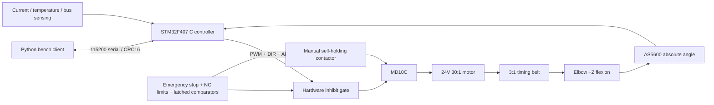

# Open Elbow Exoskeleton

[中文](README.md) | English

A modular, single-elbow research exoskeleton for robotics teaching and control-algorithm development. The first engineering release includes editable parametric mechanical designs, STM32F407 C firmware, a Python bench client, and a single-joint simulation running the **same C control core**.

**Current stage: software and simulation prototype. No physical bench or wearing measurements have been performed in this delivery.** Continuous assistance of0.5Nm, peak assistance of1Nm for1s, velocity of1rad/s, and worn mass of1.5kg are design targets. The current-to-torque conversion is a calculation estimate. Development proceeds through software simulation, an instrumented single-joint bench, and then wearing validation.


## Delivered engineering files

| Subsystem | Deliverable | Evidence boundary |
|---|---|---|
| Mechanical | CadQuery parametric source, assembly and individual STEP/STL files, dimensions, assembly instructions, load calculations | Geometry only; no machining or physical load test |
| Transmission | Pololu4692 24V 30:1 geared motor,20/60-tooth open timing belt,90:1 total reduction | Selected design; thermal behavior, torque, and backdrivability remain unmeasured |
| Electrical | Wiring SVG, pin table, netlist, power budget, three-tier BOM, emergency-stop/limit/overcurrent/temperature/inhibit design | Engineering wiring design; no assembled PCB claim |
| Firmware | Original C control core, STM32F407VET6 register-level implementation, native simulated device | Native build and actual Arm cross-build completed |
| Host software | Serial/simulated connection, explicit calibration and arming, configuration, status, CSV logging, plotting, Tk GUI | Process-based communication exercised |
| Simulation | URDF, one-degree-of-freedom dynamics, shared C controller, trajectory and injected faults | Synthetic model and sensors; no hardware-performance claim |

The recorded validation includes **394 C assertions**, **25 Python communication tests**, and **7 simulation fault cases**. See the [validation report](docs/validation/README.md) and [firmware build record](firmware/VALIDATION.md) for commands, results, and limits.

## Quick start without hardware

Use Python3.10–3.12; Python3.12 is recommended for CAD. Run from the repository root.

Windows PowerShell:

```powershell
py -3.12 -m venv .venv
.venv\Scripts\Activate.ps1
python -m pip install -e ".[test]" ziglang==0.14.1
python firmware/build.py --target host
python -m elbow_exo demo --output artifacts/demo
python -m elbow_exo gui --port sim
```

Linux/macOS with a native C compiler installed:

```bash
python3 -m venv .venv
source .venv/bin/activate
python -m pip install -e '.[test]'
python firmware/build.py --target host
python -m elbow_exo demo --output artifacts/demo
```

The demo connects to a real local C-controller process, maintains heartbeat, calibrates at zero, represents manual bench-fixture movement, runs and stops the joint, and writes CSV/plots to `artifacts/demo/`. The GUI requires Tk; Linux distributions commonly provide it through `python3-tk`.

Interactive operation:

```bash
python -m elbow_exo console --port sim --log artifacts/bench.csv
python -m elbow_exo console --port COM5 --log artifacts/physical-bench.csv
python -m elbow_exo plot artifacts/bench.csv --output artifacts/bench.png
```

For the simulated bench, enter `CAL`, wait for calibration to finish, then enter `inject Q 0.225`, `ARM`, `TARGET 0.5`, `status`, and `STOP`. Values use rad,rad/s,Nm. On a physical bench, the operator moves the unpowered joint in its fixture; **injection commands do not exist in the physical protocol**. Clearing a fault requires the physical reset-button edge and `RESET`, followed by calibration. In v0.1 a new host session starts sequence numbers at0; reset the physical controller before establishing a new host session.

## Architecture and common conventions



[config/robot.json](config/robot.json) is the single parameter source. Extension is zero; positive flexion follows the right-hand rule around+Z. The open belt preserves rotation direction. Software range is10–120°, while mechanical stops are0–130°. Firmware, URDF, simulation, and CAD use the shared parameters. Regenerate every affected artifact after a parameter change.

## Engineering documentation

- [Requirements, calculations, transmission comparison, acceptance criteria](docs/engineering.md)
- [Mechanical source, STEP/STL, drawings, materials, assembly](mechanical/README.md)
- [Wiring, pins, power, BOM, procurement sources](hardware/README.md)
- [Firmware build, flashing, calibration, fault codes, protocol](firmware/README.md)
- [Host operation, simulation, and tests](docs/OPERATIONS.md)
- [Executed validation](docs/validation/README.md) and [bench/wearing record templates](docs/HARDWARE_TESTS.md)
- [Budget](hardware/BOM.md), [contributing](CONTRIBUTING.md), [roadmap](docs/ROADMAP.md), [third-party sources](THIRD_PARTY.md)

The detailed engineering notes are currently primarily Chinese; this English README provides the complete operating entry point.

## Build and validation commands

Install the official GNU Arm Embedded toolchain and expose `arm-none-eabi-gcc` on PATH:

```bash
python firmware/build.py --target stm32
python -m pytest -q
python simulation/build_model.py
python simulation/validate.py --output artifacts/simulation
python -m pip install '.[cad]'
python mechanical/source/build_cad.py
```

Arm artifacts are `firmware/build/stm32/open_elbow.elf` and `.bin`. The [firmware instructions](firmware/README.md) include SWD flashing, zero-fixture prerequisites, and the protocol. Use an ASCII toolchain installation directory on Windows; the tested GNU Arm distribution failed to find its runtime libraries when installed under a non-ASCII path. The repository itself can remain in a non-ASCII directory.

No control board, motor, power supply, or probe is assumed to be already owned. ROS2 is an optional future integration and is not required for this release.

## BOM and cost assumptions

Prices were queried on **2026-11-13**, in CNY. All tiers retain the selected motor, driver, hardware-protection chain, and firmware limits.

| Tier | Hardware and fixtures | With20% contingency | Scope |
|---|---:|---:|---|
| Economy | ¥1,941.84 | ¥2,330.21 | Lower structure-processing and fixture budget |
| **Standard: selected baseline** | **¥3,111.84** | **¥3,734.21** | 6061 load-bearing structure, full electrical protection, bench/calibration fixtures |
| Extended | ¥5,523.84 | ¥6,628.61 | Better fixtures, reference force sensing/acquisition, spares; added sensing is not part of the initial closed loop |

Pololu's product page provided a USD60.95 motor price, converted using the **assumed**7.20CNY/USD rate. Other prices are budget estimates, not verified quotations. International freight/import taxes, labor, computer/oscilloscope/multimeter, wearing studies, and conversion to battery/BLDC hardware are excluded. Item quantities, sources, dates, and estimate flags are in [hardware/bom.csv](hardware/bom.csv).

## Licenses

Original software (`firmware/`, `software/`, `simulation/` code, `tests/`, `tools/`, and CI) is **Apache-2.0**. Original mechanical and electrical design files are **CERN-OHL-W-2.0**. Original documentation and explanatory illustrations are **CC-BY-4.0**. See [license scope](LICENSE.md). Third-party files retain their original licenses; binary runtime notices are retained under [firmware/third_party_licenses/](firmware/third_party_licenses/).

## FAQ

**Can it run without a motor?** Yes. The default`sim`connection runs the same compiled C controller locally. Simulation does not establish physical performance.

**Does current measure actual output torque?** The current mapping uses extrapolated manufacturer stall data. It does not capture static friction, varying efficiency, or thermal effects. Physical torque calibration needs a known lever/load or a reference force sensor.

**Can the entire assembly be printed?** Primary plates, shaft, hubs, and stops are designed as metal parts. Printed parts support fit checks, covers, and cuff prototypes; see the mechanical documentation.

**What remains before wearing validation?** Establish and record bench direction, range, torque calibration, thermal behavior, alignment, release operation, electrical protection, and fault-reset behavior. No wearing-test result is claimed in this release.
