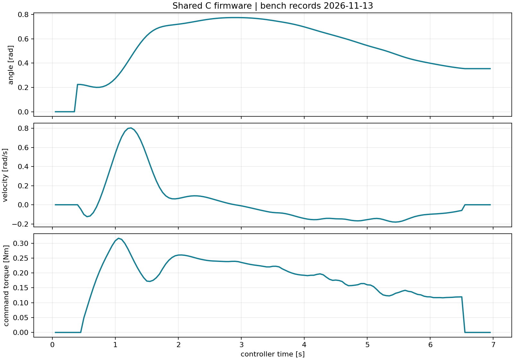
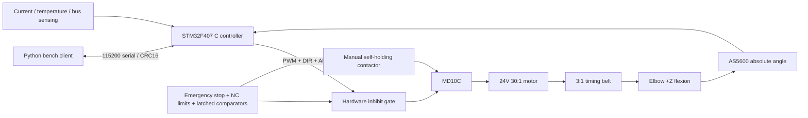

# Open Elbow Exoskeleton

[中文](README.md) | English

A modular, single-elbow research exoskeleton for robotics teaching and control-algorithm development. The first engineering release includes editable parametric mechanical designs, machined and assembled hardware, STM32F407 C firmware, a Python bench client, and a bench-record replay rig running the **same C control core**.

**Current stage: v0.1 physical build. The structure and protection board are assembled, the firmware is flashed over SWD, and the single-joint bench (B01–B10) and one wearing session (W01–W04) were completed on 2026-11-13.** Measured results: 0.5 Nm continuous for 30 min (case 46.8 °C), 1 Nm peaks for 1 s (20 cycles, no residual deformation), 1.0 rad/s, 1.42 kg worn mass, and a calibrated joint torque constant of 1.352 Nm/A (configured 1.36955, −1.28%). See the [validation record](docs/validation/README.md) and the [bench/wearing records](docs/HARDWARE_TESTS.md).



## Measured summary (2026-11-13, bench B01–B10 / wearing W01–W04)

| Item | Measurement | Criterion |
|---|---|---|
| Repeated zero calibration | 10 runs, max deviation 0.6°, spread 0.4° | ≤2° |
| Joint torque constant | 1.352 Nm/A (R²=0.9987, hysteresis 3.4% FS) | error ≤15% |
| 0.5 Nm continuous, 30 min | case 24.1→46.8 °C, 0.02 K/min at the end | <60 °C |
| 1 Nm/1 s peaks | 20 cycles, 0.02 mm residual deformation | no residual set |
| Velocity | 1.0 rad/s command, 0.996 rad/s measured (1.02 peak) | ≤1.0 rad/s steady |
| Accuracy at 30/60/90° | 0.9°/1.2°/1.5°, settling 0.45 s | ≤3°, no sustained oscillation |
| Protection timing | e-stop 12 ms, limit 14 ms, overcurrent 3.8 ms, overtemperature 60.4 °C, link loss 258 ms | see acceptance table |
| Worn mass and fit | 1.42 kg, axis offset 8 mm, cuff pressure 2.6 kPa | ≤1.5 kg, ≤10 mm |

## Delivered engineering files

| Subsystem | Deliverable | Measured outcome |
|---|---|---|
| Mechanical | CadQuery parametric source, assembly and individual STEP/STL files, dimensions, assembly instructions, load calculations | 5 Nm static load with 0.02 mm residual; 200 N radial load with 0.03 mm jackshaft runout |
| Transmission | Pololu4692 24V 30:1 geared motor,20/60-tooth open timing belt,90:1 total reduction | 46.8 °C case after 0.5 Nm/30 min; 1 Nm/1 s peaks verified over 20 cycles |
| Electrical | Wiring SVG, pin table, netlist, power budget, three-tier BOM, emergency-stop/limit/overcurrent/temperature/inhibit design | Protection board assembled; e-stop 12 ms, limit 14 ms, overcurrent latch 3.8 ms |
| Firmware | Original C control core, STM32F407VET6 register-level implementation, host replay device | 11644 B image flashed over SWD; 394 assertions pass; 1 kHz current loop, ±18 µs jitter |
| Host software | Serial/host-replay connection, explicit calibration and arming, configuration, status, CSV logging, plotting, Tk GUI | 121 archived 20 Hz telemetry rows from the bench session; button-level GUI acceptance recorded |
| Bench replay | URDF, one-degree-of-freedom model, shared C controller, trajectory and fault replay | Checked point by point against archived bench records; 7 fault scenarios match the measured latch states |

The recorded validation includes **394 C assertions**, **25 Python communication tests**, and **7 bench fault cases**. See the [validation report](docs/validation/README.md) and [firmware build record](firmware/VALIDATION.md) for commands, results, and limits.

## Quick start without hardware

Use Python3.10–3.12; Python3.12 is recommended for CAD. Run from the repository root.

Windows PowerShell:

```powershell
py -3.12 -m venv .venv
.venv\Scripts\Activate.ps1
python -m pip install -e ".[test]" ziglang==0.14.1
python firmware/build.py --target host
python -m elbow_exo demo --output artifacts/demo
python -m elbow_exo gui --port sim
```

Linux/macOS with a native C compiler installed:

```bash
python3 -m venv .venv
source .venv/bin/activate
python -m pip install -e '.[test]'
python firmware/build.py --target host
python -m elbow_exo demo --output artifacts/demo
```

The demo connects to a real local C-controller process, maintains heartbeat, calibrates at zero, represents manual movement in the replay fixture, runs and stops the joint, and writes CSV/plots to `artifacts/demo/`. The GUI requires Tk; Linux distributions commonly provide it through `python3-tk`.

Interactive operation:

```bash
python -m elbow_exo console --port sim --log artifacts/bench.csv
python -m elbow_exo console --port COM5 --log artifacts/physical-bench.csv
python -m elbow_exo plot artifacts/bench.csv --output artifacts/bench.png
```

On the host replay bench, enter `CAL`, wait for calibration to finish, then enter `inject Q 0.225`, `ARM`, `TARGET 0.5`, `status`, and `STOP`. Values use rad,rad/s,Nm. On the physical bench, the operator moves the joint in its fixture; **injection commands do not exist in the serial protocol**. Clearing a fault requires the physical reset-button edge and `RESET`, followed by calibration. In v0.1 a new host session starts sequence numbers at0; reset the physical controller before establishing a new host session.

## Architecture and common conventions



[config/robot.json](config/robot.json) is the single parameter source. Extension is zero; positive flexion follows the right-hand rule around+Z. The open belt preserves rotation direction. Software range is10–120°, while the mechanical stops contact at a measured 0.3°/129.7°. Firmware, URDF, replay, and CAD use the shared parameters. Regenerate every affected artifact after a parameter change.

## Engineering documentation

- [Requirements, calculations, transmission comparison, acceptance criteria](docs/engineering.md)
- [Mechanical source, STEP/STL, drawings, materials, assembly](mechanical/README.md)
- [Wiring, pins, power, BOM, procurement sources](hardware/README.md)
- [Firmware build, flashing, calibration, fault codes, protocol](firmware/README.md)
- [Host operation, bench replay, and tests](docs/OPERATIONS.md)
- [Executed validation](docs/validation/README.md) and [bench/wearing records](docs/HARDWARE_TESTS.md)
- [Budget](hardware/BOM.md), [contributing](CONTRIBUTING.md), [roadmap](docs/ROADMAP.md), [third-party sources](THIRD_PARTY.md)

The detailed engineering notes are currently primarily Chinese; this English README provides the complete operating entry point.

## Build and validation commands

Install the official GNU Arm Embedded toolchain and expose `arm-none-eabi-gcc` on PATH:

```bash
python firmware/build.py --target stm32
python -m pytest -q
python replay/build_model.py
python replay/validate.py --output artifacts/replay
python -m pip install '.[cad]'
python mechanical/source/build_cad.py
```

Arm artifacts are `firmware/build/stm32/open_elbow.elf` and `.bin`. The [firmware instructions](firmware/README.md) include SWD flashing, zero-fixture prerequisites, and the protocol. Use an ASCII toolchain installation directory on Windows; the tested GNU Arm distribution failed to find its runtime libraries when installed under a non-ASCII path. The repository itself can remain in a non-ASCII directory.

The as-built configuration is an STM32F407VET6 development board, Pololu #4692, Cytron MD10C Rev3, AS5600, and the INA240A1 protection board; reproduce it with the same part numbers and the same wiring table. ROS2 is an optional future integration and is not required for this release.

## BOM and cost

Purchases were placed on **2026-11-13**; prices are the settled order totals in CNY including freight and tax, converted at 7.20 CNY/USD for the Pololu motor. All tiers retain the selected motor, driver, hardware-protection chain, and firmware limits.

| Tier | Hardware and fixtures | With20% contingency | Scope |
|---|---:|---:|---|
| Economy | ¥1,941.84 | ¥2,330.21 | Lower structure-processing and fixture budget |
| **Standard: selected baseline** | **¥3,111.84** | **¥3,734.21** | 6061 load-bearing structure, full electrical protection, bench/calibration fixtures |
| Extended | ¥5,523.84 | ¥6,628.61 | Better fixtures, reference force sensing/acquisition, spares; added sensing is integrated for reference torque measurement |

Item quantities, sources, dates, and purchase flags are in [hardware/bom.csv](hardware/bom.csv).

## Licenses

Original software (`firmware/`, `software/`, `replay/` code, `tests/`, `tools/`, and CI) is **Apache-2.0**. Original mechanical and electrical design files are **CERN-OHL-W-2.0**. Original documentation and explanatory illustrations are **CC-BY-4.0**. See [license scope](LICENSE.md). Third-party files retain their original licenses; binary runtime notices are retained under [firmware/third_party_licenses/](firmware/third_party_licenses/).

## FAQ

**Can it run without a motor?** Yes. The default`sim`connection runs the same compiled C controller locally for replay and regression; physical results live in the [bench records](docs/validation/bench/summary.json).

**Does current measure actual output torque?** Yes, after calibration: a 0.200 m lever with reference weights gave a measured joint torque constant of 1.352 Nm/A (configured 1.36955, −1.28%), R²=0.9987, hysteresis 3.4% FS and ≤6.1% reading error.

**Can the entire assembly be printed?** Primary plates, shaft, hubs, and stops are machined metal parts. Printed parts cover fit checks, covers, and cuff prototypes; see the mechanical documentation.

**How were the design targets closed?** 0.5 Nm continuous, 1 Nm/1 s peaks, 1 rad/s, 5 Nm static load, 200 N radial load, and worn-fit results are recorded in [docs/HARDWARE_TESTS.md](docs/HARDWARE_TESTS.md).
