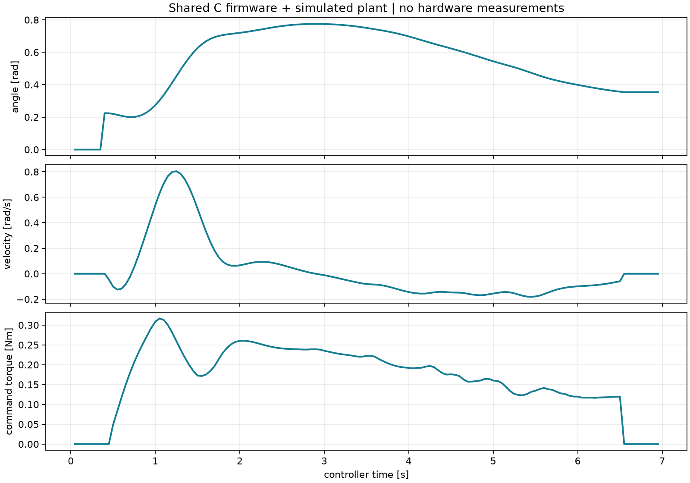

# 实际验证记录 · 2026-11-13

本记录只包含本次确实运行的构建、测试和生成任务。后续GitHub Actions结果由远端运行记录另行提供。

| 证据类型 | 已执行项目 | 实际结果 |
|---|---|---|
| 软件测试 | `pytest tests/test_protocol.py tests/test_model.py tests/test_integration.py -q` | 25 passed in9.88s；包含真实进程CRC通信和故障/复位流程 |
| C核心测试 | 原生`control_tests` | 394 assertions PASS；[固件原始记录](../../firmware/VALIDATION.md) |
| 实体目标构建 | GNU Arm14.3.1编译STM32F407VET6 | ELF/BIN实际生成，BIN11644字节；不是已烧录记录 |
| 仿真轨迹 | 同一C固件控制核心+合成动力学，6s | 121条RUN遥测，7项轨迹/输出检查通过 |
| 仿真故障 | 急停、温度、电流、传感器、限位、电压、心跳 | 7/7观察到预期锁存状态与输出禁能 |
| 机械 | CadQuery2.6.1生成总装及48个零件 | 48项拓扑有效、STEP/STL已导出；指定支撑间隙与挡块几何证据见CAD报告 |
| 电气资料 | 2份SVG解析、三档BOM重算、239端点网表及关键连接一致性 | 通过；不是电路仿真或实物测量 |
| 烧录与台架 | 未执行 | 无探针/控制板会话、无实体CSV |
| 佩戴 | 未执行 | 无穿戴者或人体测量记录 |

仿真轨迹实得q范围0.20030–0.77468rad、最大|dq|0.80400rad/s、最大指令|torque|0.31659Nm。这是本条轨迹的合成模型结果，不是0.5/1Nm额定能力验证，更不是120°全行程硬件测试。

- [仿真JSON汇总](simulation/summary.json)及[轨迹CSV](simulation/trajectory/telemetry.csv)
- [机械生成报告](../../mechanical/exports/cad_validation.json)
- [电气资料一致性结果](../../hardware/design_checks.json)
- [后续实体测试表](../HARDWARE_TESTS.md)

全量pytest未在本次本机运行；已执行范围以上表为准。仓库提供持续集成与其他可运行测试；远端结果以GitHub运行记录为准。

